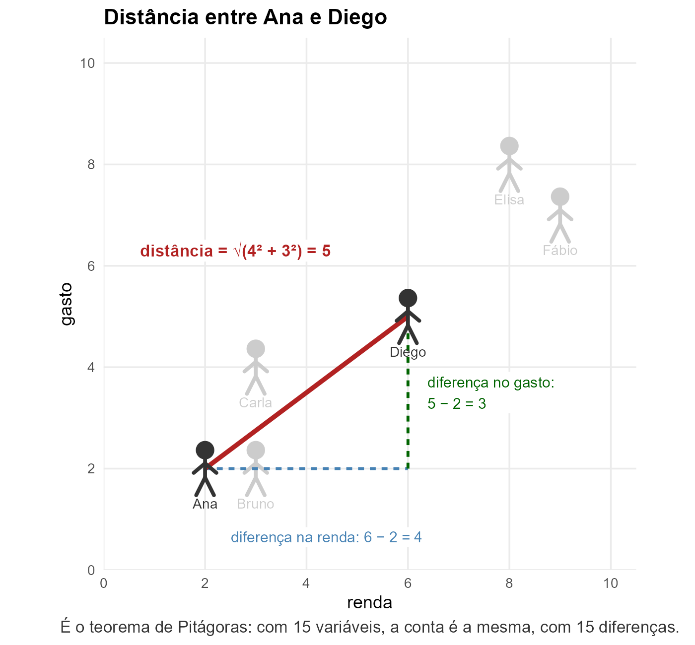
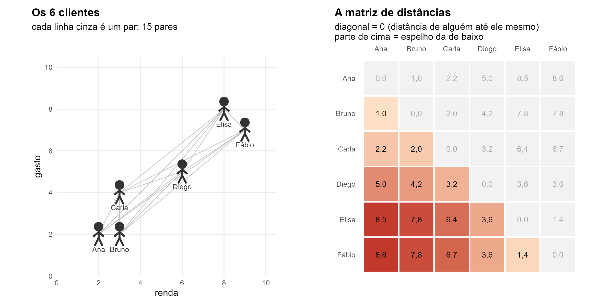
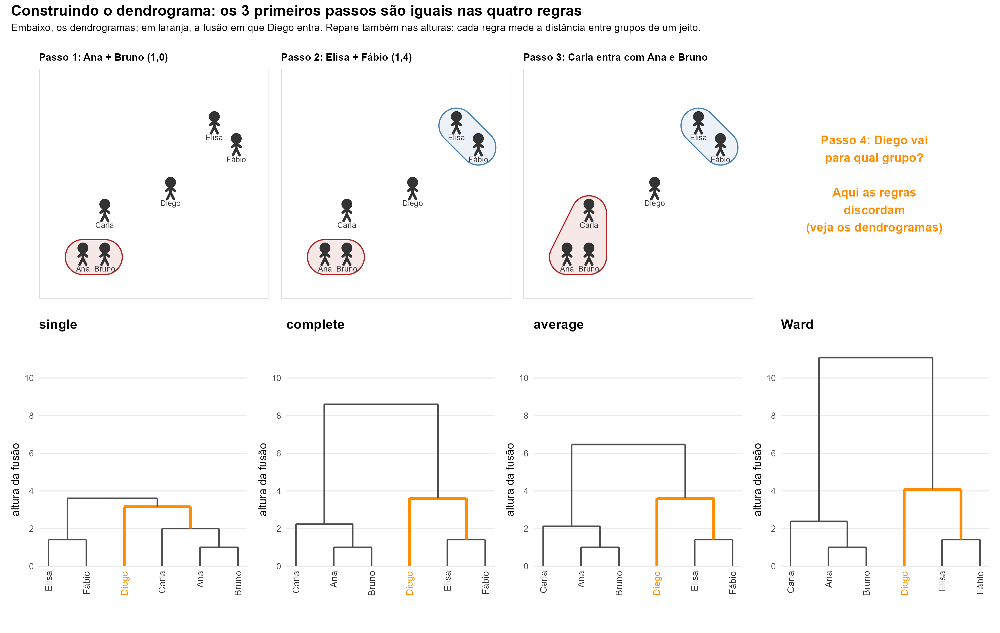
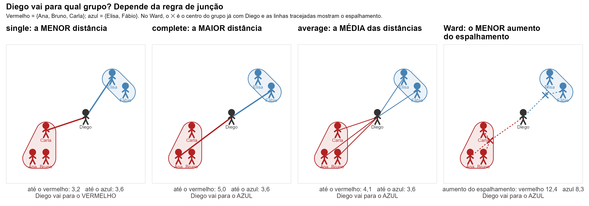
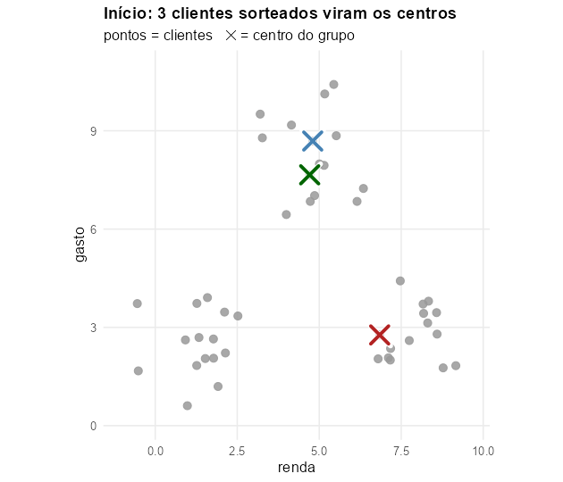

# 1. Problema de negócio e setup

## O problema de negócio

Imagine que nós somos a **equipe de dados de uma rede de varejo**. Hoje, toda campanha de marketing (cupom, e-mail, folheto) é enviada **igual para todos os clientes**. O resultado é conhecido: quem gosta de vinho premium recebe o mesmo cupom de quem só compra itens em promoção, e ninguém se sente "visto" pela loja.

A saída é **segmentar** a base: dividir os clientes em **grupos parecidos entre si e diferentes dos outros grupos**, para tratar cada grupo de um jeito. Em estatística, isso é um problema de **análise de agrupamentos** (*clustering*): não existe uma "resposta certa" para conferir, e é o algoritmo que sugere os grupos a partir dos dados.

Por que não criar os grupos com uma **regra fixa**, por exemplo "renda alta" e "renda baixa"? Porque o comportamento de compra depende de **várias coisas ao mesmo tempo** (quanto gasta, onde compra, se tem filhos em casa, se usa promoções). Uma regra só com a renda esconde diferenças importantes, e um corte como "ganha mais de X por ano" é arbitrário. Os algoritmos de clustering olham para todas as variáveis juntas.

O que vamos fazer hoje:

1. **Entender e preparar os dados** de clientes;
2. **Agrupar** os clientes com três técnicas (hierárquica, k-means e k-medoides);
3. **Comparar** as técnicas e escolher uma;
4. **Entregar "fichas de segmento"**: para cada grupo, um nome, um perfil em linguagem de negócio e uma ação de marketing sugerida.

A entrega final **não é um gráfico bonito**: é a ficha que o time de marketing consegue usar na segunda-feira.

## Sobre os dados

Vamos usar a base *Customer Personality Analysis*, com **2.240 clientes** de uma empresa de varejo (compras de vinho, frutas, carnes, peixes, doces e ouro; canais de compra; resposta a campanhas). O arquivo `marketing_campaign.csv` já está na pasta da aula: **nada é baixado durante a aula**.

## Um mínimo de R para começar

*(Pode pular se a turma já souber R.)* Estas ideias bastam para acompanhar a aula:

- **Objetos** guardam coisas. Criamos um objeto com a "setinha" `<-`.
- **Funções** fazem coisas. Elas têm nome e parênteses: `mean(x)`, `round(3.14159, 2)`.
- O **pipe** `|>` passa o resultado da esquerda para a função da direita. Lemos como **"e então"**.
- Uma **tabela** de dados (no tidyverse, chamada de *tibble*) tem uma coluna por variável. Pegamos uma coluna com o cifrão: `clientes$Income` é a coluna `Income` da tabela `clientes`.
- Para o R encontrar os arquivos, abra sempre a aula pelo arquivo **`clustering.Rproj`** (duplo clique): o RStudio já "entra" na pasta certa.

```{r}
# 1. Problema de negócio e setup ----

# AULA: Quem são os nossos clientes? (MAT02053 - UFRGS)
# Somos a equipe de dados de uma rede de varejo e vamos segmentar os clientes
# para personalizar as campanhas. Rode o script bloco a bloco (Ctrl + Enter).
# Este arquivo é gerado a partir de aula_clustering.qmd (veja o HTML com as explicações).

# Criando um objeto chamado "gastos" com quatro valores
gastos <- c(100, 250, 300, 150)

# Aplicando uma função ao objeto: a média dos gastos
mean(gastos)

# O mesmo cálculo usando o pipe: "pegue gastos E ENTÃO calcule a média"
gastos |> mean()

# Pipes podem ser encadeados: média e então arredondamento com 1 casa
gastos |> mean() |> round(1)
```

## Pacotes

Pacotes são "caixas de ferramentas" que estendem o R. O bloco abaixo **instala apenas os pacotes que ainda não estão no seu computador** (isso só precisa acontecer uma vez) e depois os carrega.

```{r}
# Lista de pacotes usados na aula
pacotes <- c("tidyverse",   # manipulação (dplyr), leitura (readr) e gráficos (ggplot2)
             "cluster")     # pam() (k-medoides), silhouette() e daisy() (Gower)

# Quais ainda não estão instalados?
faltando <- pacotes[!sapply(pacotes, requireNamespace, quietly = TRUE)]

# Instala só os que faltam (se não faltar nenhum, não faz nada)
if (length(faltando) > 0) install.packages(faltando)

# Carrega os pacotes
library(tidyverse)
library(cluster)
```

## Lendo os dados

::: {.callout-important}
Abra sempre a aula pelo arquivo **`clustering.Rproj`**. Assim o RStudio já "entra" na pasta certa e o R encontra o `marketing_campaign.csv`.
:::

O arquivo é separado por **TAB** (a tecla de tabulação), e não por vírgula, apesar de se chamar `.csv`. Por isso usamos `read_tsv()`. Se usássemos `read_csv()` (que espera vírgulas), o R não encontraria nenhuma vírgula e leria **cada linha inteira como uma única coluna**, com tudo misturado. Se a tabela vier com 1 coluna, é esse o problema.

```{r}
# Conferindo se estamos na pasta certa antes de ler os dados
if (!file.exists("marketing_campaign.csv")) {
  stop("Não encontrei o arquivo marketing_campaign.csv. ",
       "Feche o RStudio e abra o arquivo clustering.Rproj ",
       "(ou use o menu Session > Set Working Directory > Choose Directory ",
       "e escolha a pasta clustering).")
}

# read_tsv() lê arquivos separados por TAB
clientes_raw <- read_tsv("marketing_campaign.csv")

# Primeira olhada: quantas linhas e colunas, e o tipo de cada coluna
glimpse(clientes_raw)
```

São **2.240 clientes** e **29 colunas**. Na seção 2, o `summary()` vai mostrar que `Income` (renda anual) tem alguns valores ausentes (`NA`): cuidaremos deles na preparação dos dados.

# 2. Estatísticas descritivas

Antes de agrupar qualquer coisa, precisamos **conhecer os clientes**. Esta seção responde, uma pergunta de marketing de cada vez, "como é a nossa base?". Ela também vai nos mostrar **problemas nos dados** que teremos de resolver na seção 3.

## Visão geral da base

**Pergunta do marketing:** *quais informações temos sobre cada cliente, e há algo estranho nos números?*

O `glimpse()` da seção anterior já mostrou o tipo de cada coluna. Agora o `summary()` resume as colunas numéricas (mínimo, quartis, média, máximo e quantidade de `NA`). Vamos olhar só algumas colunas-chave para a tabela caber na tela.

```{r}
# 2. Estatísticas descritivas ----

# Selecionando algumas colunas-chave e pedindo o resumo estatístico de cada uma
clientes_raw |>
  select(Year_Birth, Income, Kidhome, Teenhome, Recency, MntWines, NumStorePurchases) |>
  summary()
```

Três coisas chamam atenção. A **renda máxima é 666.666**, muito acima do terceiro quartil (68.522) e da média (52.247): é suspeita. O `Income` tem **24 valores ausentes** (`NA`). E o **ano de nascimento mínimo é 1893**, o que daria um cliente com mais de 120 anos: os três menores valores são 1893, 1899 e 1900, idades implausíveis (o seguinte já é 1940), provavelmente erros de digitação. Vamos investigar a renda com um gráfico.

## Renda: quem ganha o quê?

**Pergunta do marketing:** *qual é a faixa de renda típica dos nossos clientes?*

```{r}
#| fig-cap: "Histograma da renda anual (Income)"

# Histograma da renda: cada barra conta quantos clientes caem numa faixa de renda
clientes_raw |>
  ggplot(aes(x = Income)) +
  geom_histogram(bins = 40, fill = "steelblue", color = "white", na.rm = TRUE) +
  labs(x = "Renda anual (unidades monetárias)", y = "Número de clientes")
```

Quase todos os clientes estão entre 0 e 160 mil, mas o eixo vai até 666 mil por causa de **um único cliente** com renda 666.666. As rendas seguintes mais altas são 162.397, 160.803 e 157.733, ou seja, esse ponto está **muito isolado** (um *outlier*). Isso distorce médias e, mais adiante, distorceria as distâncias entre clientes. Trataremos disso na seção 3.

## Gasto total: quanto os clientes gastam?

**Pergunta do marketing:** *os clientes gastam valores parecidos, ou existe um grupo que gasta muito mais que os outros?*

Há seis colunas de gasto (vinhos, frutas, carnes, peixes, doces e ouro). Somamos as seis para obter o gasto total de cada cliente, apenas para este gráfico.

```{r}
#| fig-cap: "Distribuição do gasto total (soma das seis categorias)"

# Gasto total = soma das seis colunas de valor gasto (as que começam com "Mnt")
gasto_total_tmp <- clientes_raw |>
  mutate(gasto_total = MntWines + MntFruits + MntMeatProducts +
           MntFishProducts + MntSweetProducts + MntGoldProds)

# Histograma do gasto total
gasto_total_tmp |>
  ggplot(aes(x = gasto_total)) +
  geom_histogram(bins = 40, fill = "darkorange", color = "white") +
  labs(x = "Gasto total (unidades monetárias)", y = "Número de clientes")

# Comparando mediana e média do gasto total
gasto_total_tmp |>
  summarise(mediana = median(gasto_total), media = mean(gasto_total))
```

A distribuição é **assimétrica à direita**: muitos clientes gastam pouco e poucos gastam muito. A **mediana é 396**, mas a **média é 605,8**; a média é puxada para cima pelos grandes gastadores. Variáveis assim têm uma "cauda longa" que domina as distâncias entre clientes. Por isso, na seção 3, vamos aplicar o **logaritmo** nos gastos antes de agrupar: ele "comprime" a cauda e deixa os clientes mais comparáveis.

## Em que os clientes gastam?

**Pergunta do marketing:** *quais categorias de produto geram mais receita?*

As seis colunas `Mnt*` estão "lado a lado". Para fazer um gráfico com uma barra por categoria, usamos `pivot_longer()`, que as empilha em duas colunas: o nome da categoria e o valor.

```{r}
#| fig-cap: "Gasto médio por categoria de produto"

# Gasto médio de cada categoria, em formato "longo" (uma linha por cliente e categoria)
gasto_categoria <- clientes_raw |>
  select(starts_with("Mnt")) |>                         # só as seis colunas de gasto
  pivot_longer(everything(),                            # empilha todas as colunas
               names_to = "categoria", values_to = "gasto") |>
  group_by(categoria) |>                                # um grupo por categoria
  summarise(gasto_medio = mean(gasto))                  # média por categoria

# Gráfico de barras, ordenado do menor para o maior gasto médio
gasto_categoria |>
  ggplot(aes(x = reorder(categoria, gasto_medio), y = gasto_medio)) +
  geom_col(fill = "steelblue") +
  coord_flip() +                                        # barras na horizontal
  labs(x = "Categoria", y = "Gasto médio por cliente (unidades monetárias)")

# A mesma informação em números
gasto_categoria |> arrange(desc(gasto_medio))
```

**Vinhos** lideram com gasto médio de 303,9, cerca de metade do gasto médio total (605,8), seguidos por **carnes** (166,9). Frutas (26,3), doces (27,1), peixes (37,5) e produtos "ouro" (44,0) pesam bem menos. Vinho e carne são, portanto, as categorias que mais "movem" as diferenças entre clientes.

## Por onde os clientes compram?

**Pergunta do marketing:** *em quais canais (loja, site, catálogo) e com que uso de promoções os clientes compram?*

```{r}
#| fig-cap: "Número médio de compras por canal"

# Média de compras em cada canal (NumDealsPurchases = compras feitas com desconto)
compras_canal <- clientes_raw |>
  select(NumStorePurchases, NumWebPurchases, NumCatalogPurchases, NumDealsPurchases) |>
  pivot_longer(everything(), names_to = "canal", values_to = "compras") |>
  group_by(canal) |>
  summarise(compras_medias = mean(compras))

# Gráfico de barras com a média de compras por canal
compras_canal |>
  ggplot(aes(x = reorder(canal, compras_medias), y = compras_medias)) +
  geom_col(fill = "darkgreen") +
  coord_flip() +
  labs(x = "Canal", y = "Número médio de compras por cliente")

# A mesma informação em números
compras_canal |> arrange(desc(compras_medias))
```

A **loja física** é o canal mais usado (5,79 compras por cliente em média), seguida pelo **site** (4,08) e pelo **catálogo** (2,66). As compras com desconto têm média de 2,33. Como a média esconde diferenças entre clientes, esperamos que **grupos diferentes** usem canais diferentes.

## Perfil familiar e escolaridade

**Pergunta do marketing:** *os clientes têm filhos em casa, e qual o nível de escolaridade?*

`Kidhome` conta as crianças em casa e `Teenhome`, os adolescentes. Somando os dois, temos o total de filhos em casa.

```{r}
#| fig-cap: "Número de filhos em casa (crianças + adolescentes)"

# Total de filhos em casa (crianças + adolescentes)
filhos_tmp <- clientes_raw |>
  mutate(filhos = Kidhome + Teenhome)

# Gráfico de barras do número de filhos
filhos_tmp |>
  ggplot(aes(x = factor(filhos))) +
  geom_bar(fill = "purple4") +
  labs(x = "Filhos em casa", y = "Número de clientes")

# Em números
filhos_tmp |> count(filhos)
```

```{r}
#| fig-cap: "Escolaridade dos clientes"

# Gráfico de barras do nível de escolaridade (Education), ordenado pela frequência
clientes_raw |>
  ggplot(aes(x = reorder(Education, Education, length))) +
  geom_bar(fill = "firebrick") +
  coord_flip() +
  labs(x = "Escolaridade", y = "Número de clientes")

# Em números
clientes_raw |> count(Education, sort = TRUE)
```

A maioria das famílias tem **1 filho** em casa (1.128 clientes), enquanto 638 clientes não têm nenhum e só 53 têm 3. Quanto à escolaridade, `Graduation` é o nível mais comum (1.127 clientes, metade da base), seguido de `PhD` (486) e `Master` (370). Note que `2n Cycle` (203) e `Master` são provavelmente equivalentes, mas aparecem separados nos dados.

## Estado civil: os dados estão limpos?

**Pergunta do marketing:** *como se distribui o estado civil dos clientes?*

```{r}
# Contagem de clientes por estado civil, do mais ao menos frequente
clientes_raw |> count(Marital_Status, sort = TRUE)
```

As categorias comuns são `Married` (864), `Together` (580), `Single` (480), `Divorced` (232) e `Widow` (77). Mas aparecem também **`Alone` (3), `Absurd` (2) e `YOLO` (2)**: rótulos que não são estados civis de verdade (`Alone` equivale a `Single`; `Absurd` e `YOLO` são lixo de digitação). São poucos casos, mas um bom exemplo de que **dados reais precisam de limpeza** antes de qualquer análise.

## O que levamos para a próxima seção

- **Ano de nascimento:** três valores impossíveis (1893, 1899 e 1900).
- **Renda:** um outlier de 666.666 e 24 valores ausentes.
- **Gastos:** distribuição muito assimétrica, o que motiva o uso do logaritmo.
- **Estado civil:** categorias estranhas (`Absurd`, `YOLO`, `Alone`).

Na seção 3 vamos corrigir tudo isso e criar as variáveis que usaremos no agrupamento.

# 3. Preparação dos dados

Os algoritmos de clustering **não sabem** que 1893 é um ano de nascimento impossível, nem que 666.666 é uma renda suspeita: eles tratam qualquer número como verdadeiro. Por isso, antes de agrupar, vamos (1) **limpar** os problemas que vimos na seção 2, (2) **criar variáveis** mais úteis para o negócio, (3) **escolher** quais variáveis entram no agrupamento e (4) **colocá-las na mesma escala**.

## Limpeza dos dados

Cada regra abaixo é um passo separado, e o código mostra quantos clientes sobram em cada um. Assim sabemos exatamente o que foi removido e por quê.

**Passo 1: renda ausente.** O algoritmo precisa de um número para calcular a distância entre clientes; com `NA`, a conta não fecha. Como são só 24 clientes (cerca de 1% da base), vamos **removê-los** em vez de inventar uma renda para eles.

**Passo 2: renda extrema.** O cliente de renda 666.666 está muito isolado dos demais (a seguinte mais alta é 162.397). Ele seria quase um grupo sozinho e distorceria as distâncias. Como corte, usamos **200.000**: fica acima de todas as rendas "normais" e abaixo do ponto suspeito.

**Passo 3: ano de nascimento impossível.** Os anos 1893, 1899 e 1900 (clientes com mais de 110 anos) são provavelmente erros de digitação. Removemos quem nasceu **antes de 1920**; o próximo ano mais antigo da base é 1940.

```{r}
# 3. Preparação dos dados ----

# Quantos clientes temos antes da limpeza?
nrow(clientes_raw)

# Passo 1: removendo quem não tem renda informada (NA)
passo1 <- clientes_raw |>
  filter(!is.na(Income))
nrow(passo1)                    # quantos sobraram?

# Passo 2: removendo a renda extrema (acima de 200.000)
passo2 <- passo1 |>
  filter(Income <= 200000)
nrow(passo2)

# Passo 3: removendo anos de nascimento impossíveis (antes de 1920)
passo3 <- passo2 |>
  filter(Year_Birth >= 1920)
nrow(passo3)
```

Saímos de **2.240** para **2.212** clientes: 24 sem renda, 1 com renda extrema e 3 com ano de nascimento impossível (nenhum dos três tinha `Income` ausente, por isso as contas se somam). Perdemos cerca de 1,2% da base, um custo pequeno para dados bem mais confiáveis.

**Estado civil.** Em vez de 8 categorias (algumas sem sentido), vamos usar só duas: **`"Casado/Junto"`** (`Married` e `Together`, que vivem com um parceiro) e **`"Sozinho"`** (todo o resto: `Single`, `Divorced`, `Widow`, `Alone`, e também `Absurd` e `YOLO`). Agrupar o "resto" é uma decisão simples: os rótulos sem sentido são só 4 clientes, e o que importa para o marketing é haver ou não um parceiro em casa.

**Colunas sem informação.** `Z_CostContact` e `Z_Revenue` têm o mesmo valor para todos os clientes: não distinguem ninguém, então saem.

## Variáveis derivadas

Muitas vezes, uma variável nova é mais útil do que as originais. Vamos criar cinco:

- **`Idade`**: `2014 - Year_Birth`. Usamos 2014 porque é o ano do cadastro mais recente da base (veja `Tempo_casa_dias` abaixo): é como se "hoje" fosse o meio de 2014, e não o ano atual.
- **`Filhos`**: crianças + adolescentes em casa (`Kidhome + Teenhome`).
- **`Gasto_total`**: soma das seis colunas `Mnt*`.
- **`Compras_total`**: soma das compras no site, no catálogo e na loja.
- **`Tempo_casa_dias`**: há quantos dias a pessoa é cliente. A coluna `Dt_Customer` vem como texto no formato dia-mês-ano, então usamos `dmy()` para o R entendê-la como data e contamos os dias até **29/06/2014**, a data de cadastro mais recente da base.

```{r}
# Aplicando todas as regras de limpeza de uma vez, na mesma sequência dos passos acima
clientes <- clientes_raw |>
  filter(!is.na(Income),            # passo 1: renda informada
         Income <= 200000,          # passo 2: sem renda extrema
         Year_Birth >= 1920) |>     # passo 3: ano de nascimento plausível
  # Agrupando o estado civil em duas categorias
  # (x %in% c(...) pergunta "x é um destes valores?" e responde TRUE ou FALSE)
  mutate(Marital_Status = if_else(Marital_Status %in% c("Married", "Together"),
                                  "Casado/Junto", "Sozinho")) |>
  # Removendo as colunas constantes
  select(-Z_CostContact, -Z_Revenue) |>
  # Criando as variáveis derivadas
  mutate(Idade = 2014 - Year_Birth,
         Filhos = Kidhome + Teenhome,
         Gasto_total = MntWines + MntFruits + MntMeatProducts +
           MntFishProducts + MntSweetProducts + MntGoldProds,
         Compras_total = NumWebPurchases + NumCatalogPurchases + NumStorePurchases,
         # dmy() transforma o texto "dia-mês-ano" em data; a diferença entre datas é em dias
         Tempo_casa_dias = as.numeric(as.Date("2014-06-29") - dmy(Dt_Customer)))

# Conferindo: quantos clientes temos agora?
nrow(clientes)

# Como ficaram o estado civil e as novas variáveis?
clientes |> count(Marital_Status)
clientes |>
  select(Idade, Filhos, Gasto_total, Compras_total, Tempo_casa_dias) |>
  summary()
```

Conferindo os números: `Casado/Junto` tem **1.428** clientes e `Sozinho`, **784**. A `Idade` vai de **18 a 74 anos** (mediana 44), plausível para clientes de varejo. `Tempo_casa_dias` vai de **0 a 699 dias**: o cliente mais novo acabou de entrar e o mais antigo tem quase dois anos de casa.

## Escolhendo as variáveis para agrupar

Que informações devem dizer "quem se parece com quem"? Vamos usar **15 variáveis** que descrevem **comportamento de compra** e **perfil**:

- **Perfil:** `Income`, `Idade`, `Filhos`;
- **Comportamento:** `Recency` (dias desde a última compra), os **seis gastos** `Mnt*` e as compras e visitas por canal (`NumDealsPurchases`, `NumWebPurchases`, `NumCatalogPurchases`, `NumStorePurchases`, `NumWebVisitsMonth`).

Ficam **de fora**:

- **Campanhas e reclamações** (`AcceptedCmp1` a `5`, `Response`, `Complain`): queremos descobrir os grupos pelo **jeito de comprar** e só **depois** testar se eles respondem de forma diferente às campanhas. Se usássemos a resposta para formar os grupos, a validação seria circular.
- **Variáveis categóricas** (`Education`, `Marital_Status`): a distância euclidiana (a "régua" que usaremos) só funciona com números. Elas ficam para o bloco bônus (distância de Gower), que lida com dados mistos.
- **Totais** (`Gasto_total`, `Compras_total`): são somas de variáveis que estão na lista, e incluí-los contaria o mesmo comportamento duas vezes. Eles servirão para **descrever** os segmentos depois.
- **`Tempo_casa_dias`**: mede há quanto tempo a pessoa é cliente, e não o seu jeito de comprar nem o seu perfil. Também fica só para **descrever** os segmentos depois.

```{r}
# Variáveis que entram no agrupamento (somente comportamento e perfil)
vars_cluster <- c("Income", "Idade", "Filhos", "Recency",
                  "MntWines", "MntFruits", "MntMeatProducts",
                  "MntFishProducts", "MntSweetProducts", "MntGoldProds",
                  "NumDealsPurchases", "NumWebPurchases", "NumCatalogPurchases",
                  "NumStorePurchases", "NumWebVisitsMonth")

# Quantas variáveis?
length(vars_cluster)
```

## Gastos: o logaritmo (`log1p`)

Na seção 2 vimos que os gastos têm cauda longa. Vamos ver o efeito de aplicar o logaritmo, usando `MntWines` como exemplo. Usamos **`log1p(x)`**, que calcula `log(1 + x)`: é o logaritmo "seguro" para gastos que podem ser zero, porque `log(0)` não existe, mas `log1p(0)` vale 0 (há 13 clientes com gasto zero em vinhos). O logaritmo comprime os valores grandes: a diferença entre gastar 1.000 e 1.100 fica muito menor do que a diferença entre gastar 10 e 110.

```{r}
#| fig-cap: "MntWines antes e depois do log1p"

# Colocando o gasto original e o gasto em log lado a lado, para comparar
vinhos <- tibble(`Original` = clientes$MntWines,
                 `Com log1p` = log1p(clientes$MntWines)) |>
  pivot_longer(everything(), names_to = "escala", values_to = "valor") |>
  # fixando a ordem dos painéis: original primeiro
  mutate(escala = factor(escala, levels = c("Original", "Com log1p")))

# Dois histogramas, um por escala (cada painel tem seu próprio eixo x)
vinhos |>
  ggplot(aes(x = valor)) +
  geom_histogram(bins = 30, fill = "steelblue", color = "white") +
  facet_wrap(~ escala, scales = "free_x") +
  labs(x = "Gasto com vinhos", y = "Número de clientes")

# Média e mediana nas duas escalas
tibble(escala = c("Original", "Com log1p"),
       media = c(mean(clientes$MntWines), mean(log1p(clientes$MntWines))),
       mediana = c(median(clientes$MntWines), median(log1p(clientes$MntWines))))
```

No gráfico original, a maioria dos clientes se amontoa à esquerda, com uma cauda longa à direita: a **média (305,3) é bem maior que a mediana (175,5)**. Na escala logarítmica, os clientes se espalham de forma mais equilibrada. Ainda sobra uma barra isolada à esquerda: são os clientes com gasto zero. Faremos o mesmo nos seis gastos.

Agora montamos `dados_cluster`: a tabela só com as variáveis escolhidas, com `log1p()` aplicado nas seis colunas `Mnt*`.

```{r}
# Tabela só com as variáveis do agrupamento; log1p() nas seis colunas que começam com "Mnt"
dados_cluster <- clientes[vars_cluster] |>
  mutate(across(starts_with("Mnt"), log1p))

# Conferindo: uma linha por cliente, 15 colunas, nenhum NA
dim(dados_cluster)
anyNA(dados_cluster)
```

## Por que padronizar? Um experimento

As variáveis estão em **unidades muito diferentes**: `Income` está na casa das dezenas de milhares, e `Filhos` vai de 0 a 3. O clustering usa a **distância entre clientes** (o "Pitágoras" generalizado: somamos os quadrados das diferenças em cada variável e tiramos a raiz), então uma variável com números grandes pode "mandar sozinha" na distância. Primeiro, o desvio-padrão (o quanto cada variável varia) de cada uma:

```{r}
# Desvio-padrão de cada variável, em ordem decrescente
sapply(dados_cluster, sd) |>
  round(2) |>
  sort(decreasing = TRUE)
```

O desvio-padrão de `Income` (**21.527**) é mais de 700 vezes o da segunda variável que mais varia (`Recency`, 28,94). Vamos ver o efeito. Escolhemos um cliente (o primeiro da base) e procuramos os **3 clientes mais parecidos com ele**, de dois jeitos: com os dados **sem padronizar** e com os dados **padronizados** (`scale()`, que explicamos logo depois). A tabela mostra a distância de cada vizinho e `pct_income`, a **porcentagem da distância ao quadrado que vem só de `Income`**.

```{r}
# Padronizando: scale() subtrai a média e divide pelo desvio-padrão de cada coluna.
# Depois disso, cada variável tem média 0 e desvio-padrão 1 (guardamos o resultado em dados_pad)
dados_pad <- scale(dados_cluster)

# Função que acha os 3 vizinhos mais próximos do cliente 1 em uma matriz de dados
tres_vizinhos <- function(m) {
  # Diferença de cada cliente para o cliente 1, variável por variável
  dif <- sweep(m, 2, m[1, ])
  # Distância = raiz da soma dos quadrados das diferenças
  distancia <- sqrt(rowSums(dif^2))
  # Posições dos 3 mais próximos (a posição 1 é o próprio cliente, com distância 0)
  viz <- order(distancia)[2:4]
  # Tabela: quem são, quão longe estão e quanto da distância vem de Income
  tibble(vizinho = viz,
         distancia = round(distancia[viz], 2),
         pct_income = round(100 * dif[viz, "Income"]^2 / rowSums(dif[viz, ]^2), 1)) |>
    bind_cols(clientes[viz, c("Income", "Idade", "Filhos", "Gasto_total")])
}

# O cliente 1 (a referência)
clientes[1, c("Income", "Idade", "Filhos", "Gasto_total")]

# Vizinhos SEM padronizar
tres_vizinhos(as.matrix(dados_cluster))

# Vizinhos COM padronização
tres_vizinhos(dados_pad)
```

**Sem padronizar**, os três "vizinhos mais próximos" têm renda quase idêntica à do cliente de referência (58.113, 58.116 e 58.086, contra 58.138), mas são **bem diferentes no resto**: o cliente 1 gastou 1.617 no total, e os vizinhos gastaram 758, 443 e 792. `Income` responde por **80,4%, 47,3% e 78,1%** da distância ao quadrado: uma única variável, entre 15, decide quase metade ou mais da distância. **Padronizando**, os vizinhos são outros (posições 2135, 38 e 879), com rendas entre 48.948 e 60.896, mas mais parecidos no conjunto das 15 variáveis (no gasto, por exemplo: todos gastam mais de 900 no total), embora a idade agora varie mais (71 anos nos dois últimos, contra 57 do cliente de referência; sem padronizar, eram 55, 58 e 45). `Income` cai para **0,3% a 3,4%** da distância: agora cada variável tem voz. Repare que os dois últimos vizinhos (IDs 2968 e 8800) têm exatamente os mesmos valores nas 15 variáveis (distância igual): provavelmente é um registro duplicado na base.

## Padronização (z-score)

O que o `scale()` faz é o **z-score**: para cada valor, subtrai-se a média da coluna e divide-se pelo desvio-padrão. O resultado diz "**quantos desvios-padrão** este cliente está acima ou abaixo da média": 0 é um cliente na média, +1 é um desvio acima, −2 são dois abaixo. Como toda variável passa a ter média 0 e desvio-padrão 1, **todas valem igual** na distância.

```{r}
# Conferindo: toda coluna deve ter média 0 (arredondada) e desvio-padrão 1
round(colMeans(dados_pad), 4)
apply(dados_pad, 2, sd)

# Dimensão final da matriz que usaremos nas próximas seções
dim(dados_pad)
```

As 15 médias são 0 e os 15 desvios-padrão são 1, como esperado. A matriz `dados_pad` (**2.212 clientes × 15 variáveis**, já limpa, com log nos gastos e padronizada) é a base das próximas seções.

# 4. Cluster hierárquico

Agora sim vamos agrupar. Todas as técnicas desta aula partem da mesma pergunta: **quão longe um cliente está do outro?** Clientes "perto" devem cair no mesmo grupo; clientes "longe", em grupos diferentes.

## Distância entre clientes e a matriz de distâncias

A **distância euclidiana** é a régua que já usamos na seção 3: para dois clientes, calculamos a diferença em cada uma das 15 variáveis padronizadas, elevamos ao quadrado, somamos e tiramos a raiz (o "Pitágoras" com 15 lados). A função `dist()` faz essa conta para **todos os pares de clientes** de uma vez e guarda o resultado numa **matriz de distâncias**: uma tabela em que a linha *i* e a coluna *j* dizem a distância entre o cliente *i* e o cliente *j*.

Para enxergar a ideia, começamos com um exemplo de brinquedo: **6 clientes** com só **2 variáveis** (renda e gasto, numa escala de 0 a 10), para que caibam num gráfico. Com 2 variáveis, a distância entre dois clientes é o comprimento da linha reta que os liga:



Fazendo essa conta para **todos os pares** (com 6 clientes, são 15 pares), montamos a **matriz de distâncias**:



Vamos montar o mesmo exemplo no R e pedir a matriz com `dist()`:

```{r}
# 4. Cluster hierárquico ----

# Exemplo de brinquedo: 6 clientes com 2 variáveis (renda e gasto, de 0 a 10)
exemplo <- tibble(
  nome  = c("Ana", "Bruno", "Carla", "Diego", "Elisa", "Fábio"),
  renda = c(2, 3, 3, 6, 8, 9),
  gasto = c(2, 2, 4, 5, 8, 7)
)
exemplo

# Matriz só com as duas variáveis, com o nome de cada cliente nas linhas
m_exemplo <- as.matrix(exemplo[, c("renda", "gasto")])
rownames(m_exemplo) <- exemplo$nome

# Matriz de distâncias dos 6 clientes (arredondada em 1 casa)
dist_exemplo <- dist(m_exemplo)
round(dist_exemplo, 1)
```

Os números são os da figura: Ana e Diego estão a **5,0**, Ana e Bruno (os mais próximos) a **1,0**. Com os clientes de verdade, a conta é a mesma, só que com 15 variáveis em vez de 2. Vamos ver com só **3 clientes** antes de usar a base inteira.

```{r}
# Matriz de distâncias de apenas 3 clientes (as 3 primeiras linhas de dados_pad)
dist(dados_pad[1:3, ]) |> round(2)

# Conferindo à mão a distância entre o cliente 1 e o cliente 2:
# diferença em cada variável, ao quadrado, somada, e a raiz
sqrt(sum((dados_pad[1, ] - dados_pad[2, ])^2)) |> round(2)
```

A saída mostra só a "metade de baixo" da tabela, porque a distância de 1 até 2 é a mesma de 2 até 1, e a distância de um cliente até ele mesmo é 0. A conta "à mão" bate com o valor da linha 2, coluna 1. Agora, a matriz para todos os clientes:

```{r}
# Matriz de distâncias euclidianas entre TODOS os pares de clientes
dist_euc <- dist(dados_pad)

# Quantas distâncias foram calculadas? (um número para cada par de clientes)
length(dist_euc)
```

São **2.445.366 distâncias** (2.212 × 2.211 / 2 pares). Por isso o clustering hierárquico fica pesado em bases muito grandes: o número de pares cresce muito rápido com o número de clientes.

## Como juntar dois grupos? Quatro regras

O cluster **hierárquico aglomerativo** começa com **cada cliente sozinho no seu próprio grupo** e, a cada passo, **junta os dois grupos mais próximos**, até sobrar um grupo só com todo mundo. Enquanto cada grupo tem um cliente só, "os mais próximos" é fácil: é a menor distância da matriz. Mas quando um grupo já tem vários clientes, **qual é a distância entre dois grupos?** Há várias regras para responder, chamadas de **ligações**. Veja a construção da árvore com os 6 clientes:



Nos três primeiros passos, as quatro regras concordam: Ana e Bruno são os mais próximos (1,0), depois Elisa e Fábio (1,4), e Carla entra no grupo de Ana e Bruno. No passo 4, a pergunta é: **Diego, que está no meio do caminho, vai para qual grupo?** Aqui as regras discordam:



- **single** (ligação simples): a distância entre dois grupos é a **menor** distância entre um cliente de um grupo e um cliente do outro (os "vizinhos mais próximos"). Diego está a 3,2 de Carla e a 3,6 de Elisa e de Fábio, então vai para o grupo vermelho (Ana, Bruno e Carla).
- **complete** (ligação completa): é a **maior** distância entre os clientes dos dois grupos. Até o grupo vermelho, a maior é 5,0 (até Ana); até o azul, 3,6. Diego vai para o azul (Elisa e Fábio).
- **average** (ligação média): é a **média** de todas as distâncias entre os clientes dos dois grupos. Até o vermelho, a média é 4,1; até o azul, 3,6. Diego vai para o azul.
- **Ward**: não compara distâncias entre pares de clientes. Mede o **espalhamento** de cada grupo (a soma das distâncias ao quadrado de cada cliente até o centro do grupo, o "cliente médio", marcado com ✕) e escolhe **a fusão que menos aumenta o espalhamento**. Juntar Diego ao vermelho aumenta o espalhamento em 12,4; ao azul, em 8,3. Diego vai para o azul. (O dendrograma do Ward usa uma escala diferente para as alturas, então esses números não aparecem nele como estão.)

A matriz de distâncias é a mesma; só muda a regra, e já no passo 4 a árvore é outra. Conferindo no R:

```{r}
#| fig-cap: "Dendrogramas dos 6 clientes com as quatro regras de ligação"
#| fig-height: 7

# As quatro regras de ligação aplicadas aos 6 clientes
hc_exemplo <- list(
  single   = hclust(dist_exemplo, method = "single"),
  complete = hclust(dist_exemplo, method = "complete"),
  average  = hclust(dist_exemplo, method = "average"),
  ward     = hclust(dist_exemplo, method = "ward.D2")
)

# Os quatro dendrogramas na mesma janela (dividida em 2 linhas e 2 colunas)
par(mfrow = c(2, 2))
plot(hc_exemplo$single,   main = "single",   xlab = "", sub = "", ylab = "Altura da fusão")
plot(hc_exemplo$complete, main = "complete", xlab = "", sub = "", ylab = "Altura da fusão")
plot(hc_exemplo$average,  main = "average",  xlab = "", sub = "", ylab = "Altura da fusão")
plot(hc_exemplo$ward,     main = "Ward",     xlab = "", sub = "", ylab = "Altura da fusão")
par(mfrow = c(1, 1))   # volta a janela gráfica ao normal
```

No single, Diego entra no ramo de Ana, Bruno e Carla; nas outras três regras, no ramo de Elisa e Fábio. Repare também nas **alturas**: como cada regra mede a distância entre grupos de um jeito, as alturas das fusões mudam de uma regra para outra (a última fusão fica a 3,6 no single, 8,6 no complete, 6,5 no average e 11,1 no Ward).

## E na base real?

Agora, as três primeiras regras nos 2.212 clientes (a mesma `dist_euc`), cortando cada árvore em 3 grupos:

```{r}
# As três ligações "intuitivas" na base real
hc_single   <- hclust(dist_euc, method = "single")
hc_complete <- hclust(dist_euc, method = "complete")
hc_average  <- hclust(dist_euc, method = "average")

# Tamanhos dos grupos quando cortamos cada árvore em 3 grupos
table(cutree(hc_single, k = 3))
table(cutree(hc_complete, k = 3))
table(cutree(hc_average, k = 3))
```

O resultado é decepcionante. Com a single, os grupos têm **2.208**, **3** e **1** cliente; com a complete, **2.199**, **9** e **4**; com a average, **2.205**, **4** e **3**. Em vez de dividir a base, as três regras deixam quase todo mundo num grupo só e separam poucos clientes (de 4 a 13) muito diferentes dos demais. O motivo é que esta base **não tem grupos bem separados**: os clientes formam um contínuo, sem "vazios" entre eles (voltaremos a isso na seção 5). A single sofre com o **encadeamento**: num contínuo, sempre há um vizinho próximo ligando um cliente ao seguinte, e tudo acaba num grupo só. A complete e a average não encadeiam, mas aqui os poucos clientes muito isolados ficam para as últimas fusões e acabam virando "grupos" quase vazios. Para o marketing, isso não serve: precisamos de uma regra que forme grupos compactos e de tamanhos úteis.

## A ligação de Ward

É aqui que entra o **Ward**, a quarta regra da figura: em cada passo, ele junta os dois grupos cuja fusão **menos aumenta o espalhamento** em volta dos centros. Assim, evita fusões que criariam grupos grandes e espalhados e prefere formar **grupos compactos**, que é o que queremos para segmentar. (Essa ideia de "espalhamento em volta do centro" volta na seção 5, com o nome de WSS.) Em R, é o `method = "ward.D2"` (a versão de Ward que trabalha com as distâncias euclidianas como elas são).

```{r}
# Clustering hierárquico com a ligação de Ward, a partir da matriz de distâncias
hc_ward <- hclust(dist_euc, method = "ward.D2")

# O resultado guarda a sequência de fusões; conferindo o método usado
hc_ward$method
```

## O dendrograma

O histórico das fusões é desenhado num **dendrograma** (uma "árvore"). Na base ficam os 2.212 clientes; subindo, as linhas se juntam sempre que dois grupos se fundem. A **altura** de cada junção mostra o quanto aquela fusão "custou": junções altas unem grupos **muito diferentes**. Com 2.212 clientes, os nomes na base seriam um borrão preto, então não mostramos os rótulos.

```{r}
#| fig-cap: "Dendrograma (ligação de Ward) dos 2.212 clientes"

# Desenhando o dendrograma sem os rótulos dos clientes (labels = FALSE)
# hang = -1 alinha todos os clientes na base do gráfico
plot(hc_ward, labels = FALSE, hang = -1,
     main = "Dendrograma (Ward)", xlab = "Clientes", sub = "",
     ylab = "Altura da fusão")
```

Para "ler" a árvore com números, olhamos as alturas das **últimas fusões** (as do topo). Se a altura cai muito de uma fusão para a seguinte, cortar a árvore entre elas separa grupos bem distintos.

```{r}
# Alturas das 6 últimas fusões, da mais alta (a última, que junta tudo) para a mais baixa
rev(tail(hc_ward$height, 6)) |> round(1)
```

A última fusão (que junta 2 grupos em 1) tem altura **147,4**; a anterior (de 3 grupos para 2), **82,5**. Depois disso as alturas caem pela metade e ficam parecidas entre si: **42,2**, **41,7**, **36,8** e **29,6**. Ou seja, juntar os clientes até sobrarem **3 grupos** é "barato", mas juntar esses 3 grupos é "caro": a árvore sugere **3 grupos**. (Note, porém, que a fusão mais "cara", de 147,4 para 82,5, também sugeriria **2 grupos**; voltamos a isso na seção 5.) Vamos usar `k_escolhido = 3`, uma decisão **que vamos conferir na seção 5** com o cotovelo e a silhueta do k-means (e com a pergunta "isso serve ao marketing?").

## Cortando a árvore em k grupos

"Cortar" o dendrograma numa altura em que restam *k* ramos dá *k* grupos. A função `cutree()` faz isso e devolve, para cada cliente, o número do seu grupo.

```{r}
#| fig-cap: "Dendrograma cortado em 3 grupos"

# Número de grupos (k): sugerido pelo dendrograma; conferido na seção 5
k_escolhido <- 3L

# Cortando a árvore em k grupos: um número de grupo (1, 2, 3...) para cada cliente
grupos_hc <- cutree(hc_ward, k = k_escolhido)

# Quantos clientes em cada grupo?
table(grupos_hc)

# O mesmo dendrograma, com retângulos marcando os k grupos
plot(hc_ward, labels = FALSE, hang = -1,
     main = "Dendrograma (Ward) cortado em 3 grupos", xlab = "Clientes", sub = "",
     ylab = "Altura da fusão")
rect.hclust(hc_ward, k = k_escolhido, border = c("firebrick", "steelblue", "darkgreen"))
```

O corte em 3 grupos gera grupos de **825**, **838** e **549** clientes: nenhum grupo minúsculo, o que é bom para o marketing (não vale a pena criar uma campanha para 10 pessoas). Quem é cada grupo veremos na seção 8; antes, vamos ver outras técnicas.

# 5. K-means

## A ideia do k-means

O k-means não constrói uma árvore. Ele recebe o número de grupos *k* e procura ***k* "centros"** que resumam os clientes. O **centroide** de um grupo é o "cliente médio" do grupo: a média de cada variável entre os clientes que estão nele (ele não precisa ser um cliente real). O algoritmo funciona assim:

1. **Sorteia** *k* clientes para servirem de centros iniciais;
2. **Atribui** cada cliente ao centro mais próximo (distância euclidiana);
3. **Recalcula** cada centro como o centroide (a média) dos clientes que caíram nele;
4. **Repete** os passos 2 e 3 até ninguém mais trocar de grupo.

A animação mostra o algoritmo em 45 clientes com 2 variáveis. Os ✕ são os centros: começam em 3 clientes sorteados (passo 1) e, a cada iteração, os clientes mudam de cor conforme o centro mais próximo (passo 2) e cada centro anda até a média do seu grupo (passo 3, a seta). Quando ninguém muda de cor, o algoritmo para.



Para medir se os grupos ficaram bons, usamos a **WSS** (*within sum of squares*, soma de quadrados dentro dos grupos): a soma das distâncias ao quadrado de cada cliente até o centroide do seu grupo. **Quanto menor a WSS, mais compactos os grupos.** O k-means tenta deixá-la a menor possível.

## O sorteio inicial importa: `nstart`

O passo 1 é um **sorteio**. Com um sorteio "azarado", o algoritmo pode parar numa solução pior, da qual não consegue sair. Para ver isso, rodamos o k-means duas vezes com um único sorteio (`nstart = 1`) e **sementes diferentes**. A semente (`set.seed()`) fixa o sorteio, para que todos na turma obtenham o mesmo resultado. Aqui escolhemos de propósito uma semente (6) em que o sorteio dá errado; entre as sementes de 1 a 100, só a 6 dá errado (1 em 100); nas outras 99, o resultado é o bom.

```{r}
# 5. K-means ----

# Execução 1: um único sorteio inicial (nstart = 1), com a semente 1
set.seed(1)
km_semente1 <- kmeans(dados_pad, centers = k_escolhido, nstart = 1)

# Execução 2: um único sorteio inicial, com a semente 6
set.seed(6)
km_semente6 <- kmeans(dados_pad, centers = k_escolhido, nstart = 1)

# WSS total (tot.withinss) de cada execução: quanto menor, melhor
km_semente1$tot.withinss
km_semente6$tot.withinss
```

Com os mesmos dados e o mesmo *k*, a WSS foi **18.159,8** numa execução e **20.955,9** na outra: a segunda parou numa solução pior (grupos menos compactos). O remédio é o argumento **`nstart`**: o k-means faz vários sorteios iniciais (aqui, 25), roda o algoritmo a partir de cada um e **fica com o de menor WSS**. Custa um pouco mais de tempo, mas protege contra o azar. A partir daqui, sempre usaremos `nstart = 25`.

## Quantos grupos? Cotovelo e silhueta

O k-means precisa que digamos o *k*. Para conferir a escolha da seção 4, rodamos o k-means para **k de 2 a 8** e calculamos duas medidas para cada um:

- **WSS:** sempre diminui quando aumentamos *k* (com mais grupos, cada cliente fica mais perto de um centro). Por isso não escolhemos "a menor WSS", e sim o **cotovelo**: o ponto a partir do qual aumentar *k* passa a ajudar pouco.
- **Silhueta média:** para cada cliente, compara a distância média até os colegas do **próprio grupo** com a distância média até os clientes do **grupo vizinho mais próximo**. Vai de −1 a 1: perto de **1**, o cliente está bem encaixado no seu grupo; perto de **0**, está "em cima do muro" entre dois grupos; **negativa**, provavelmente está no grupo errado. A média sobre todos os clientes resume a qualidade da divisão: **quanto maior, melhor**.

```{r}
# Função que roda o k-means para um valor de k e devolve a WSS e a silhueta média
avaliar_k <- function(k) {
  set.seed(2026)                                            # sorteio reprodutível
  km_k <- kmeans(dados_pad, centers = k, nstart = 25)
  # silhouette() precisa dos grupos e da matriz de distâncias;
  # a coluna "sil_width" tem a silhueta de cada cliente
  sil <- silhouette(km_k$cluster, dist_euc)
  tibble(k = k,
         wss = km_k$tot.withinss,
         silhueta_media = mean(sil[, "sil_width"]))
}

# Aplicando a função para k = 2, 3, ..., 8 (map) e empilhando as linhas numa tabela (list_rbind)
avaliacao_k <- map(2:8, avaliar_k) |> list_rbind()
avaliacao_k
```

```{r}
#| fig-cap: "Método do cotovelo: WSS do k-means para k de 2 a 8"

# Gráfico do cotovelo: WSS em função de k
avaliacao_k |>
  ggplot(aes(x = k, y = wss)) +
  geom_line(color = "steelblue") +
  geom_point(size = 3, color = "steelblue") +
  scale_x_continuous(breaks = 2:8) +
  labs(x = "Número de grupos (k)", y = "WSS (soma de quadrados dentro dos grupos)")
```

```{r}
#| fig-cap: "Silhueta média do k-means para k de 2 a 8"

# Gráfico da silhueta média em função de k
avaliacao_k |>
  ggplot(aes(x = k, y = silhueta_media)) +
  geom_line(color = "darkorange") +
  geom_point(size = 3, color = "darkorange") +
  scale_x_continuous(breaks = 2:8) +
  labs(x = "Número de grupos (k)", y = "Silhueta média")
```

O que os números dizem:

- **Cotovelo:** de *k* = 2 para 3, a WSS cai de **21.200,7** para **18.159,8** (queda de cerca de 3.041). De 3 para 4, cai só para **17.100,7** (cerca de 1.059), e as quedas seguintes são ainda menores (cerca de 936, 690, 529 e 437). O "cotovelo" está em **k = 3**.
- **Silhueta:** a maior silhueta média é a de **k = 2 (0,318)**, e não a de k = 3 (**0,242**). Depois vem k = 4 (0,170), e de k = 5 em diante ela fica em torno de 0,13.

Ou seja, **os critérios não concordam totalmente**, e é importante dizer isso com honestidade: a silhueta prefere 2 grupos. Mas 2 segmentos é pouco para o marketing: seriam só dois tipos de cliente para 2.212 pessoas, e o dendrograma mostrou que separar um dos dois grandes ramos em dois ainda é uma fusão "cara" (altura 82,5, contra 42,2 da seguinte), ou seja, esses dois subgrupos são bem diferentes entre si. Já **k = 3** tem o cotovelo da WSS, a segunda maior silhueta (bem acima das de k = 4 em diante) e o corte sugerido pelo dendrograma. Por isso **mantemos `k_escolhido = 3`**. Não existe um "k certo": a escolha combina os números com o que é útil para o negócio, e um analista cuidadoso **mostra** essa decisão em vez de escondê-la.

Repare também que as silhuetas são **baixas**: com *k* = 3, 0,242, abaixo de 0,25, faixa que Kaufman e Rousseeuw (autores da silhueta e do PAM) descrevem como "sem estrutura substancial" (e a maior, a de *k* = 2, é só 0,318). Isso quer dizer que esta base **não tem grupos naturais bem separados**: os clientes formam um **contínuo**, e a segmentação é uma **divisão útil** desse contínuo, não a descoberta de "ilhas" que já existiam. Veremos isso na PCA da seção 8: os segmentos são "fatias" ao longo de um eixo, o de "quanto o cliente gasta". Por isso os segmentos devem ser lidos como "tipos predominantes", não como caixas fechadas.

## O k-means final

Com o *k* escolhido, rodamos o k-means final com `nstart = 25`.

```{r}
# K-means final: k_escolhido grupos, 25 sorteios iniciais, semente fixa
set.seed(2026)
km <- kmeans(dados_pad, centers = k_escolhido, nstart = 25)

# WSS da solução final (compare com as duas execuções com nstart = 1)
km$tot.withinss

# Quantas iterações (repetições dos passos 2 e 3) até estabilizar
km$iter

# Grupo de cada cliente e tamanho de cada grupo
grupos_km <- km$cluster
km$size
```

A solução final tem WSS **18.159,8**, a mesma da execução com a semente 1 e bem abaixo da execução "azarada" (20.955,9). O algoritmo estabilizou em **3 iterações**. Os grupos têm **889**, **622** e **701** clientes, tamanhos diferentes dos do hierárquico (825, 838 e 549): as duas técnicas usam a mesma régua e o mesmo *k*, mas **não precisam chegar aos mesmos grupos**. Vamos comparar as técnicas na seção 7 e descrever os segmentos na seção 8.

# 6. K-medoides (PAM)

## Centroide × medoide

O k-means resume cada grupo por um **centroide**: a média de cada variável entre os clientes do grupo. Essa média é um "cliente de mentira": ela pode ter, por exemplo, **1,24 filho**, algo que nenhum cliente tem. O **k-medoides** troca o centroide por um **medoide**: o **cliente real** do grupo que está, em média, mais perto de todos os outros clientes do grupo. É o "cliente típico" do segmento, e tem uma vantagem prática enorme: dá para mostrar ao marketing **uma pessoa de verdade** ("este é o cliente que representa o grupo"), com renda, idade e compras de verdade.

O algoritmo mais usado para o k-medoides é o **PAM** (*Partitioning Around Medoids*, "particionar em torno de medoides"). Ele faz algo parecido com o k-means, mas com clientes reais no lugar das médias:

1. **Escolhe** *k* clientes como medoides iniciais (passo *BUILD*: escolhe, um a um, o cliente que mais reduz a distância total; **não há sorteio**);
2. **Atribui** cada cliente ao medoide mais próximo;
3. **Testa trocas** (passo *SWAP*): para cada medoide, verifica se trocá-lo por outro cliente diminui a **soma das distâncias** de cada cliente até o seu medoide. Se diminuir, troca;
4. **Repete** até nenhuma troca ajudar.

## Por que o medoide é mais robusto a outliers

Um **outlier** é um valor muito fora do padrão (por exemplo, um cliente que gastou muito mais que todos os outros). A média "corre atrás" dele; o medoide, não. Um exemplo com só **5 clientes**, um deles com gasto altíssimo:

```{r}
# 6. K-medoides (PAM) ----

# Gastos de 5 clientes: quatro parecidos e um outlier (5000)
gastos_exemplo <- c(100, 120, 130, 150, 5000)

# Centroide: a média (puxada pelo outlier)
mean(gastos_exemplo)

# Medoide: para cada cliente, somamos as distâncias até todos os outros...
soma_dist <- sapply(gastos_exemplo, function(m) sum(abs(gastos_exemplo - m)))
soma_dist

# ...e o medoide é o cliente com a menor soma
gastos_exemplo[which.min(soma_dist)]
```

A média dá **1.100**, um valor que **nenhum dos 5 clientes** tem e que não descreve nem os quatro "normais" nem o outlier. O medoide é o cliente que gastou **130**, que representa bem a maioria. Isso acontece por dois motivos: o medoide precisa ser um cliente real, e o PAM soma as **distâncias** (e não as distâncias **ao quadrado**, como o k-means). Elevar ao quadrado aumenta muito o peso de quem está longe, e por isso o k-means é mais sensível a outliers.

## Rodando o PAM

Usamos a função `pam()` do pacote `cluster`, com **o mesmo *k*** (`k_escolhido = 3`) e a **mesma matriz de distâncias euclidianas** (`dist_euc`) das seções 4 e 5: assim, a comparação entre as técnicas é justa. Passar a matriz `dist_euc` (em vez de `dados_pad`) evita que o R recalcule as 2.445.366 distâncias.

Repare que **não usamos `set.seed()`** aqui: como vimos acima, o PAM **não sorteia** nada. Rodando duas vezes, o resultado é sempre o mesmo, ao contrário do k-means, que depende do sorteio inicial (e por isso precisou de `nstart`).

```{r}
# PAM com k_escolhido grupos, a partir da matriz de distâncias euclidianas
# (sem set.seed: o PAM não tem sorteio, o resultado é sempre o mesmo)
pam_euc <- pam(dist_euc, k = k_escolhido)

# Grupo de cada cliente (1, 2 ou 3)
grupos_pam <- pam_euc$clustering

# Quantos clientes em cada grupo?
table(grupos_pam)

# Posição (linha da base) dos clientes escolhidos como medoides
pam_euc$id.med
```

O PAM formou grupos de **726**, **822** e **664** clientes. Os medoides são os clientes das linhas **53**, **1270** e **1297** da base.

## Os medoides: nossos "clientes-exemplo"

Vamos ver quem são esses três clientes. Guardamos as linhas deles em `medoides`, com uma coluna `grupo` dizendo de qual grupo cada um é o representante (o 1º medoide representa o grupo 1, e assim por diante).

```{r}
# As linhas da base que são medoides, com o número do grupo que cada uma representa
medoides <- clientes[pam_euc$id.med, ] |>
  mutate(grupo = seq_len(k_escolhido), .before = 1)

# Os clientes-exemplo, com algumas variáveis fáceis de interpretar
# (as.data.frame() mostra todas as colunas, sem esconder nenhuma)
medoides |>
  select(grupo, ID, Income, Idade, Filhos, Gasto_total, Compras_total,
         NumWebPurchases, NumStorePurchases, NumWebVisitsMonth) |>
  as.data.frame()
```

Lendo cada "cliente-exemplo":

- **Grupo 1 (cliente ID 10383):** renda de **70.287**, 48 anos, **sem filhos**, gastou **1.093** no total, com **20 compras** (10 delas na loja física). Um cliente de renda alta que compra bastante.
- **Grupo 2 (cliente ID 5267):** renda de **33.986**, 44 anos, **1 filho**, gastou só **44**, com **4 compras**. Visita o site **7 vezes por mês**, mas só **1** das compras foi pela internet. Um cliente de renda baixa que olha e compra pouco.
- **Grupo 3 (cliente ID 10260):** renda de **45.143**, 49 anos, **1 filho**, gastou **311**, com **12 compras**. Um cliente intermediário.

Agora comparamos o medoide com o **centroide** (a média) de cada grupo, nas variáveis originais:

```{r}
# Centroide de cada grupo do PAM: a média de algumas variáveis originais
clientes |>
  mutate(grupo = grupos_pam) |>
  group_by(grupo) |>
  summarise(Income = mean(Income), Filhos = mean(Filhos),
            Gasto_total = mean(Gasto_total)) |>
  # arredondando: renda e gasto sem casas decimais, filhos com 2 casas
  mutate(Income = round(Income), Filhos = round(Filhos, 2),
         Gasto_total = round(Gasto_total))
```

As médias de `Filhos` são **0,35**, **1,24** e **1,24**: números que nenhum cliente real tem. Os medoides, por outro lado, têm 0, 1 e 1 filho. As médias de gasto (**1.264**, **64** e **561**) são diferentes dos gastos dos medoides (1.093, 44 e 311), porque a média é puxada para cima pelos clientes que gastam muito mais que os outros (a cauda longa que vimos na seção 2). O medoide é o cliente "do meio" do grupo, não a média. Note que, nos três grupos, o gasto do medoide fica abaixo até da mediana do grupo (1.214, 53 e 450, respectivamente): o medoide é escolhido olhando as **15 variáveis** (na escala log e padronizada), e não só o gasto.

## Silhueta do PAM

Como no k-means, medimos a qualidade dos grupos com a **silhueta** (de −1 a 1; quanto maior, mais bem encaixados os clientes estão no seu grupo). O PAM já calcula a silhueta de cada cliente e guarda em `pam_euc$silinfo`.

```{r}
#| fig-cap: "Silhueta de cada cliente no PAM (k = 3)"

# Silhueta média geral
pam_euc$silinfo$avg.width

# Silhueta média de cada grupo
pam_euc$silinfo$clus.avg.widths

# Gráfico de silhueta: uma barra por cliente, ordenadas dentro de cada grupo
# (barras abaixo de zero são clientes que talvez estejam no grupo errado)
# silhouette() calcula a silhueta de cada cliente; plot() desenha (border = NA tira o contorno das barras)
plot(silhouette(pam_euc), border = NA, col = c("steelblue", "firebrick", "darkgreen"),
     main = "Silhueta de cada cliente (PAM, k = 3)",
     xlab = "Largura da silhueta", sub = "")
```

A silhueta média do PAM é **0,230**, um pouco abaixo da do k-means com o mesmo *k* (**0,242**). As duas silhuetas usam a mesma régua (a distância euclidiana `dist_euc`), então a comparação é direta. Uma pequena diferença não surpreende: as duas técnicas buscam objetivos diferentes (o k-means minimiza a soma das distâncias **ao quadrado** até os centroides; o PAM, a soma das distâncias até os medoides) e chegam a grupos um pouco diferentes. Por grupo, a silhueta é **0,256** (grupo 1), **0,327** (grupo 2) e só **0,080** (grupo 3). O grupo 3, o "intermediário", tem muitos clientes perto da fronteira com os outros dois grupos (no gráfico, é o grupo com mais barras perto de zero ou negativas). Faz sentido: quem gasta "um pouco" fica entre quem gasta muito e quem quase não gasta.

## PAM × k-means: os grupos são parecidos?

Uma **tabela cruzada** mostra, para cada grupo do k-means (linhas), em que grupo do PAM (colunas) os clientes caíram. Os números dos grupos são só "etiquetas": o grupo 1 de uma técnica não precisa ser o grupo 1 da outra.

```{r}
# Tabela cruzada: grupos do k-means (linhas) × grupos do PAM (colunas)
table(kmeans = grupos_km, pam = grupos_pam)
```

As técnicas concordam bastante: o grupo 1 do k-means corresponde ao grupo 2 do PAM (**819** clientes em comum), o grupo 2 do k-means ao grupo 3 do PAM (**577**) e o grupo 3 do k-means ao grupo 1 do PAM (**684**). Somando, **2.080 dos 2.212 clientes** (94%) estão em grupos "equivalentes"; os 132 restantes são, em boa parte, clientes de fronteira. Na seção 7 comparamos as três técnicas lado a lado e escolhemos uma.

# 6b. Bônus: dados mistos e distância de Gower (pode pular)

::: {.callout-note}
## Bloco bônus: pode pular
Este bloco é **opcional**. Nada das seções 7 e 8 depende dele: se o tempo estiver curto, pule direto para a seção 7. No script `.R`, o bônus vai da linha `# 6b. Bônus ...` até a linha `# ---- fim do bônus 6b ----`.
:::

## Motivação: e as variáveis categóricas?

Na seção 3, deixamos de fora a **escolaridade** (`Education`) e o **estado civil** (`Marital_Status`), porque a distância euclidiana só funciona com números: não dá para calcular "PhD menos Graduation". Mas e se o marketing quiser que esses dados entrem no agrupamento? Precisamos de uma régua que aceite **dados mistos** (números e categorias ao mesmo tempo). A mais conhecida é a **distância de Gower**.

## Como a Gower mede a diferença entre dois clientes

A Gower calcula uma **dissimilaridade** (uma medida de "o quão diferentes" dois clientes são, de 0 = iguais a 1 = o mais diferentes possível) **variável por variável**, e depois tira a **média**:

- **Variável numérica:** a diferença absoluta entre os dois clientes, dividida pela **amplitude** da variável (o maior valor menos o menor valor da base). Assim, cada parcela fica entre 0 e 1, qualquer que seja a unidade. Por isso **não precisamos do `scale()`**: a Gower já coloca as variáveis na mesma escala.
- **Variável categórica:** 0 se os dois clientes estão na mesma categoria, 1 se estão em categorias diferentes.

Usamos as **mesmas 15 variáveis numéricas** da trilha principal, **com o `log1p()` nos gastos** (isto é, partimos de `dados_cluster`). O log importa aqui também: como a Gower divide pela amplitude, um único cliente com gasto enorme "esticaria" a amplitude, e as diferenças entre todos os outros clientes ficariam minúsculas. Às 15 numéricas, somamos `Education` e `Marital_Status` como **factor** (o tipo do R para variáveis categóricas). A função `daisy()` do pacote `cluster`, com `metric = "gower"`, calcula a matriz de dissimilaridades de uma só vez.

```{r}
# 6b. Bônus: dados mistos e distância de Gower (pode pular) ----
# ATENÇÃO: este bloco é OPCIONAL. Nenhuma seção seguinte usa objetos criados aqui.
# Para pular, vá direto para a linha "# ---- fim do bônus 6b ----".

# Dados mistos: as 15 numéricas (já com log1p nos gastos) + 2 categóricas como factor
dados_gower <- dados_cluster |>
  mutate(Education = factor(clientes$Education),
         Marital_Status = factor(clientes$Marital_Status))

# Conferindo o tipo de cada coluna: "numeric" ou "factor"
sapply(dados_gower, class)

# Matriz de dissimilaridades de Gower entre todos os pares de clientes
# (não usamos scale(): a Gower divide cada diferença pela amplitude da variável)
dist_gower <- daisy(dados_gower, metric = "gower")

# "mixed" = a daisy reconheceu que há variáveis numéricas e categóricas
attr(dist_gower, "Metric")

# Resumo das dissimilaridades: todas entre 0 e 1
summary(as.vector(dist_gower))
```

A `daisy()` reconheceu os dados como **mistos** (`"mixed"`), e as dissimilaridades vão de **0** a **0,67**, com mediana **0,27**.

### Conferindo à mão, com 2 clientes

Vamos refazer a conta para os clientes das linhas **1 e 3** da base. Eles têm a mesma escolaridade (`Graduation`), mas estado civil diferente: um é `Sozinho` e o outro, `Casado/Junto`.

```{r}
# Os dois clientes que vamos comparar
# (as.data.frame() mostra todas as colunas e mantém os números das linhas da base: 1 e 3)
as.data.frame(dados_gower)[c(1, 3), ]

# Amplitude (maior valor - menor valor) de cada variável numérica
# (\(x) é um atalho do R para function(x): uma função pequena, escrita ali mesmo)
amplitude <- sapply(dados_gower[vars_cluster], \(x) max(x) - min(x))

# Parcela de cada numérica: |diferença| / amplitude (sempre entre 0 e 1)
# (unlist() transforma a linha da tabela num vetor simples de números, para fazer a conta)
parcela_num <- abs(unlist(dados_gower[1, vars_cluster]) -
                   unlist(dados_gower[3, vars_cluster])) / amplitude

# Parcela de cada categórica: 0 se a categoria é a mesma, 1 se é diferente
parcela_cat <- c(
  Education = as.numeric(dados_gower$Education[1] != dados_gower$Education[3]),
  Marital_Status = as.numeric(dados_gower$Marital_Status[1] != dados_gower$Marital_Status[3]))

# As 17 parcelas, arredondadas
round(c(parcela_num, parcela_cat), 3)

# Gower = média das 17 parcelas
mean(c(parcela_num, parcela_cat))

# O valor calculado pela daisy() para o mesmo par (linha 1, coluna 3)
as.matrix(dist_gower)[1, 3]
```

As duas contas dão o mesmo valor, **0,1996** (cerca de 0,20): os dois clientes são bem parecidos. Repare nas parcelas: a de `Education` é **0** (mesma escolaridade) e a de `Marital_Status` é **1** (estado civil diferente). A maior parcela numérica é a de `NumStorePurchases` (**0,462**), menos da metade da parcela do estado civil. Uma única categórica diferente vale tanto quanto a **maior diferença possível** numa numérica (por exemplo, o cliente mais pobre contra o mais rico da base). Guarde essa observação: ela vai aparecer nos resultados.

## Hierárquico com Gower: ligação média

Com a matriz de Gower, o cluster hierárquico funciona do mesmo jeito: só precisa das dissimilaridades entre os pares. Mas **trocamos a ligação**. O Ward foi pensado para a distância euclidiana (ele mede o "aumento da variação" com médias e quadrados), e a Gower não é euclidiana. Usamos a **ligação média** (`method = "average"`, a regra do painel *average* da figura da seção 4): a distância entre dois grupos é a **média de todas as dissimilaridades** entre um cliente de um grupo e um cliente do outro. Ela usa só as dissimilaridades, então serve para qualquer régua.

> **Nota (não vamos rodar):** há quem use o Ward com a Gower depois de tirar a raiz quadrada das dissimilaridades, `hclust(sqrt(dist_gower), method = "ward.D2")`, porque a raiz deixa a Gower "mais parecida" com uma distância euclidiana. Funciona na prática, mas é uma adaptação, e não o uso para o qual o Ward foi criado. Por isso o deixamos de fora.

```{r}
# Hierárquico com a matriz de Gower e ligação média
hc_gower <- hclust(dist_gower, method = "average")
# (Ward com Gower só com ressalva, e não rodamos aqui:
#  hclust(sqrt(dist_gower), method = "ward.D2"))

# Cortando a árvore em k grupos: quantos clientes em cada grupo?
table(cutree(hc_gower, k = k_escolhido))
```

O resultado é decepcionante para o marketing: o corte em 3 grupos deixa **2.207 clientes num grupo só**, e os outros dois grupos têm **4 clientes e 1 cliente**. A ligação média tende a separar primeiro os clientes **mais atípicos** (os que estão longe de todo mundo), e só depois divide a "massa" de clientes. Isso não é um erro do R: é uma característica da ligação média, e um bom lembrete de que **a escolha da ligação muda tudo**. Para segmentar esta base com a Gower, o PAM se sai melhor.

## PAM com Gower

O PAM também só precisa das dissimilaridades entre os pares, então aceita a Gower diretamente. Usamos o mesmo *k*.

```{r}
# PAM com a matriz de Gower e o mesmo k (sem sorteio, sem set.seed)
pam_gower <- pam(dist_gower, k = k_escolhido)

# Tamanho dos grupos e silhueta média (calculada com a Gower)
table(pam_gower$clustering)
pam_gower$silinfo$avg.width
```

O PAM com Gower forma grupos de **976**, **446** e **790** clientes, com silhueta média de **0,230**. Atenção: essa silhueta usa a régua de Gower, então **não dá para compará-la** diretamente com a do PAM euclidiano (que, por coincidência, também é 0,230): são réguas diferentes.

## Por que o k-means não aceita Gower?

O k-means **não recebe uma matriz de distâncias**: ele precisa dos dados, porque o passo 3 do algoritmo calcula a **média** de cada variável no grupo. Dois problemas:

1. **Não existe média de categoria:** qual é a "média" entre `PhD` e `Graduation`?
2. O passo da média só garante que os grupos melhoram quando a régua é a **distância euclidiana ao quadrado**. Com outra régua, como a Gower, trocar o centro pela média pode até piorar os grupos.

Quem precisa de algo "tipo k-means" com dados mistos tem alternativas, que só citamos aqui: o **k-prototypes** (pacote `clustMixType`), que usa médias nas numéricas e a categoria mais frequente nas categóricas; ou transformar a matriz de Gower em coordenadas numéricas com **MDS** (escalonamento multidimensional) e rodar o k-means nelas.

Resumindo:

| Técnica | Aceita Gower? | Por quê |
|---|---|---|
| Hierárquico, ligação média ou completa | Sim | Usa só as dissimilaridades entre pares (a ligação completa usa a maior dissimilaridade entre os dois grupos) |
| Hierárquico, ligação de Ward | Com ressalva | Feito para a euclidiana; há quem use `sqrt(dist_gower)` |
| K-medoides (PAM) | Sim | Usa só as dissimilaridades; o centro é um cliente real |
| K-means | Não | Precisa da média, que não existe para categorias |

## Os segmentos mudaram com as categóricas?

Comparamos os grupos do PAM com Gower (linhas) com os do PAM euclidiano da seção 6 (colunas), que só usa as numéricas. Como as duas técnicas são PAM com o mesmo *k*, a diferença vem da **régua** (e das 2 categóricas que entraram).

```{r}
# Tabela cruzada: PAM com Gower (linhas) × PAM euclidiano (colunas)
tab_gower_vs_euc <- table(pam_gower = pam_gower$clustering, pam_euc = grupos_pam)
tab_gower_vs_euc

# Estado civil dentro de cada grupo do PAM com Gower
table(pam_gower = pam_gower$clustering, estado_civil = clientes$Marital_Status)

# ---- fim do bônus 6b ----
```

O que a tabela mostra:

- O grupo 1 da Gower junta quase todo o grupo 1 euclidiano (**723** dos 726 clientes de renda e gasto altos) com **253** clientes do grupo 3 (o intermediário).
- Os grupos 2 e 3 da Gower **não seguem** os grupos euclidianos: cada um mistura clientes do grupo 2 (os que gastam pouco) com clientes do grupo 3. A segunda tabela mostra o que os separa: o grupo 2 da Gower tem **440 clientes `Sozinho`** e só 6 `Casado/Junto`, e o grupo 3 tem **783 `Casado/Junto`** e só 7 `Sozinho`. Ou seja, entre os clientes que gastam pouco ou médio, quem decidiu a divisão foi o **estado civil**.

É o efeito que antecipamos na conta à mão: uma categórica diferente vale 1 inteiro na média, enquanto as diferenças nas numéricas costumam ser frações pequenas. Com só duas categorias, `Marital_Status` vira uma "fronteira" forte.

Isso é útil para o marketing? **Depende da pergunta.** Se a campanha for sobre produtos para casais ou famílias, separar quem vive com um parceiro de quem vive sozinho pode fazer sentido. Mas, para decidir **quanto e como cada cliente compra**, um segmento "casados que gastam pouco ou médio" é menos acionável do que os grupos euclidianos, que separam os clientes pelo **comportamento de compra**. A lição do bônus: incluir variáveis é uma **escolha** com consequências, e o analista precisa olhar o resultado e perguntar se os grupos respondem à pergunta do negócio. Na trilha principal, seguimos com os grupos euclidianos.

# 7. Comparando as técnicas

Rodamos três técnicas com **as mesmas 15 variáveis padronizadas**, **a mesma régua** (a distância euclidiana `dist_euc`) e **o mesmo *k* = 3**. Agora vamos responder duas perguntas: (1) as três técnicas encontraram os mesmos grupos? (2) qual delas vamos entregar ao marketing?

## As técnicas concordam? Tabelas cruzadas

Uma **tabela cruzada** conta quantos clientes caíram em cada combinação de grupos de duas técnicas. Um cuidado importante: **os números dos grupos são rótulos arbitrários**. Cada técnica numera os seus grupos na ordem em que os encontra, então o "grupo 1" do hierárquico **não tem nada a ver** com o "grupo 1" do k-means. Para ver se as técnicas concordam, procuramos, em cada linha, **uma casa com quase todos os clientes** (e não a diagonal da tabela).

```{r}
# 7. Comparando as técnicas ----

# Tabela cruzada: hierárquico (linhas) × k-means (colunas)
# Lembre: "grupo 1" de uma técnica NÃO é o "grupo 1" da outra (os rótulos são arbitrários)
table(hierarquico = grupos_hc, kmeans = grupos_km)

# Tabela cruzada: k-means (linhas) × PAM (colunas), a mesma que vimos na seção 6
table(kmeans = grupos_km, pam = grupos_pam)
```

Lendo a primeira tabela: o grupo 1 do hierárquico corresponde ao grupo 3 do k-means (**684** clientes em comum), o grupo 2 ao grupo 1 (**816**) e o grupo 3 ao grupo 2 (**459**). Somando, **1.959 dos 2.212 clientes** (89%) caem em grupos "equivalentes". Entre k-means e PAM, como vimos na seção 6, a concordância é ainda maior: **2.080 clientes** (94%). A maior parte das discordâncias envolve o grupo "intermediário" de cada técnica, justamente o que fica entre os outros dois. Conclusão: as três técnicas enxergam **a mesma estrutura de três grupos**, com fronteiras um pouco diferentes.

## Qualidade estatística: a silhueta de cada técnica

Para comparar a qualidade, calculamos a **silhueta média** de cada técnica, sempre com a mesma régua (`dist_euc`). Assim, os três números são diretamente comparáveis.

```{r}
# Função: recebe os grupos de uma técnica e devolve a silhueta média
# (silhouette() precisa dos grupos e da matriz de distâncias; a coluna "sil_width" é a silhueta de cada cliente)
calc_silhueta <- function(grupos) {
  mean(silhouette(grupos, dist_euc)[, "sil_width"])
}

# Tabela-resumo: uma linha por técnica, com a silhueta média e o tamanho dos grupos
comparacao_tecnicas <- tibble(
  tecnica = c("hierarquico", "kmeans", "pam"),
  silhueta_media = c(calc_silhueta(grupos_hc),
                     calc_silhueta(grupos_km),
                     calc_silhueta(grupos_pam)),
  # tamanhos dos grupos 1, 2 e 3, colados num texto só (ex.: "825 / 838 / 549")
  tamanhos = c(paste(table(grupos_hc), collapse = " / "),
               paste(table(grupos_km), collapse = " / "),
               paste(table(grupos_pam), collapse = " / ")))

comparacao_tecnicas
```

A silhueta média é **0,217** no hierárquico, **0,242** no k-means e **0,230** no PAM. O k-means fica em primeiro, mas as diferenças são **pequenas** (0,012 entre k-means e PAM) e as três estão na mesma faixa "baixa" (abaixo de 0,25) que vimos na seção 5: nenhuma técnica separa os clientes muito melhor que as outras. O hierárquico fica um pouco atrás, e uma explicação possível (nenhuma técnica otimiza a silhueta) é que ele nunca "desfaz" uma fusão feita no começo, enquanto o k-means e o PAM continuam trocando clientes de grupo até a solução estabilizar.

## A escolha final

Como a qualidade estatística quase empata, o desempate vem da **utilidade para o negócio**. Escolhemos o **PAM**:

- **Clientes-exemplo de verdade:** cada segmento do PAM vem com um **medoide**, um cliente real que representa o grupo. Para o marketing, "este é o cliente típico do segmento" é muito mais fácil de entender e usar do que uma tabela de médias.
- **Robustez:** o PAM é menos sensível a clientes extremos (os grandes gastadores da cauda longa), como vimos na seção 6.
- **Custo pequeno:** a silhueta do PAM é só 0,012 menor que a do k-means, e as duas técnicas colocam 94% dos clientes nos mesmos grupos. Na prática, os segmentos seriam quase os mesmos com o k-means.

É importante dizer isso abertamente: **o k-means teve a melhor silhueta**, e escolher o PAM é uma decisão que pesa a utilidade para o negócio junto com os números. Outro analista poderia escolher o k-means com bons argumentos, e chegaria a segmentos muito parecidos.

```{r}
# Técnica escolhida para entregar ao marketing (justificativa no texto)
tecnica_final <- "pam"

# Os grupos da técnica escolhida: um número de grupo para cada cliente
# (se trocar a técnica, troque aqui também; e os medoides deixam de valer, pois são do PAM)
grupos_final <- grupos_pam

# Conferindo: tamanho de cada grupo
table(grupos_final)
```

# 8. Resultados para o negócio

Escolhida a técnica, falta o mais importante: **traduzir os grupos em linguagem de negócio**. Vamos (1) visualizar os grupos, (2) descrever cada um nas variáveis originais, (3) dar um nome a cada segmento, (4) escrever as fichas e (5) conferir se os segmentos respondem de forma diferente às campanhas.

## Visualizando os grupos em 2D: PCA

Cada cliente é descrito por 15 variáveis, e não dá para desenhar um gráfico com 15 eixos. A **PCA** (*análise de componentes principais*) resolve isso: ela cria novas variáveis, os **componentes principais**, que são combinações das 15 originais. O **1º componente** é a direção em que os clientes **mais variam**; o 2º é a direção que mais varia entre as que sobram, e assim por diante. Desenhando só os 2 primeiros, temos um "mapa" dos clientes que perde um pouco de informação, mas guarda o principal.

A **variância explicada** diz quanto da variação total dos dados cada componente "guarda". Usamos a função `prcomp()` sobre `dados_pad` (os dados já padronizados).

```{r}
# 8. Resultados para o negócio ----

# PCA nos dados padronizados (as mesmas 15 variáveis do agrupamento)
pca <- prcomp(dados_pad)

# Variância explicada pelos 4 primeiros componentes:
# "Proportion of Variance" = de cada componente; "Cumulative Proportion" = acumulada
summary(pca)$importance[, 1:4] |> round(3)

# Peso de cada variável nos 2 primeiros componentes (ajuda a "ler" os eixos)
round(pca$rotation[, 1:2], 2)
```

O 1º componente guarda **45,7%** da variação e o 2º, **12,1%**: juntos, **57,8%**. O mapa em 2D mostra, portanto, pouco mais da metade da informação, e grupos que parecem "encostados" no mapa podem estar mais separados nas outras dimensões.

Lendo os pesos: no 1º componente, todos os **gastos**, a **renda** e as compras por catálogo e na loja têm pesos parecidos (em torno de −0,3), e `Filhos` e `NumWebVisitsMonth` têm peso positivo. Ele mede, em resumo, **"quanto o cliente gasta"**. O sinal de um componente é arbitrário (trocar todos os sinais dá o mesmo componente), então no gráfico multiplicamos o 1º por −1 para que **a direita seja "gasta mais"**. No 2º componente, os maiores pesos são de `NumDealsPurchases` (0,61), `Filhos` (0,42), `NumWebPurchases` (0,39) e `NumWebVisitsMonth` (0,34): ele mede **"compra com desconto, pela internet, e tem filhos"**.

```{r}
#| fig-cap: "Clientes nos 2 primeiros componentes principais, coloridos pelo segmento (grupo do PAM)"

# Nomes dos segmentos, do MENOR para o MAIOR gasto total médio (a regra é explicada na próxima seção)
nomes_segmentos <- c("Econômico", "Caçador de ofertas", "Premium")

# Gasto total médio de cada grupo do PAM; rank() dá a posição do grupo (1 = menor gasto)
gasto_medio_grupo <- tapply(clientes$Gasto_total, grupos_final, mean)
segmento_pca <- nomes_segmentos[rank(gasto_medio_grupo)[grupos_final]]

# Coordenadas de cada cliente nos 2 primeiros componentes, mais o nome do segmento
# (o 1º componente é multiplicado por -1 só para a direita significar "gasta mais")
pontos_pca <- tibble(CP1 = -pca$x[, "PC1"],
                     CP2 = pca$x[, "PC2"],
                     segmento = factor(segmento_pca, levels = nomes_segmentos))

# Gráfico de dispersão: um ponto por cliente, cor = segmento
pontos_pca |>
  ggplot(aes(x = CP1, y = CP2, color = segmento)) +
  geom_point(alpha = 0.5, size = 1.2) +
  labs(x = "1º componente (45,7%): quanto o cliente gasta",
       y = "2º componente (12,1%): desconto, internet e filhos",
       color = "Segmento")
```

Os três grupos aparecem **lado a lado ao longo do 1º componente**: o **Econômico** à esquerda (gasta pouco), o **Premium** à direita (gasta muito) e o **Caçador de ofertas** no meio, mais "para cima" no 2º componente (mais desconto, internet e filhos). As fronteiras entre os grupos não são vazias, e os pontos se tocam: é a silhueta baixa que vimos, agora em forma de figura: os segmentos são "fatias" de um contínuo ao longo de "quanto o cliente gasta". O agrupamento foi feito com as 15 variáveis, e não com este mapa: a PCA aqui serve **só para visualizar**.

## Perfil de cada grupo e os nomes dos segmentos

Agora descrevemos cada grupo nas **variáveis originais** (sem log e sem padronização), que o marketing entende: renda em unidades monetárias, número de filhos, gasto em 2 anos e assim por diante. Usamos médias, e para o gasto total também a mediana (lembre que o gasto tem cauda longa).

**Os nomes.** Precisamos dar um nome a cada grupo, mas **não podemos amarrar o nome ao número do grupo** (do tipo "grupo 1 = Premium"): como vimos nas tabelas cruzadas, os números são rótulos arbitrários e podem mudar se alguém trocar a técnica, os dados ou a versão de um pacote. Se mudarem, a ficha passaria a descrever o grupo errado, sem nenhum aviso. Por isso, o nome é dado por uma **regra sobre o perfil**: ordenamos os grupos pelo **gasto total médio**, do menor para o maior, e damos os nomes nessa ordem.

```{r}
# Perfil de cada grupo nas variáveis originais (médias; "_medio" no nome da coluna)
perfil_segmentos <- clientes |>
  mutate(grupo = grupos_final) |>
  group_by(grupo) |>
  summarise(n = n(),
            # across(): aplica a média a várias colunas de uma vez
            across(c(Income, Idade, Filhos, Kidhome, Teenhome, Recency,
                     Gasto_total, Compras_total, MntWines, MntMeatProducts,
                     NumDealsPurchases, NumWebPurchases, NumCatalogPurchases,
                     NumStorePurchases, NumWebVisitsMonth, Tempo_casa_dias),
                   mean, .names = "{.col}_medio"),
            Gasto_total_mediano = median(Gasto_total),
            # proporção de clientes sem filhos em casa
            Sem_filhos_prop = mean(Filhos == 0),
            # quanto (%) do gasto de TODA a base vem deste grupo
            Receita_pct = 100 * sum(Gasto_total) / sum(clientes$Gasto_total))

# Nomes dos segmentos, do MENOR para o MAIOR gasto total médio
nomes_segmentos <- c("Econômico", "Caçador de ofertas", "Premium")

# Regra: ordenar os grupos pelo gasto total médio e dar os nomes nessa ordem
# (o nome depende do perfil, e não do número que a técnica deu ao grupo)
perfil_segmentos <- perfil_segmentos |>
  arrange(Gasto_total_medio) |>
  mutate(segmento = factor(nomes_segmentos, levels = nomes_segmentos), .before = 1)

# Base de clientes com o nome do segmento de cada um
clientes_seg <- clientes |>
  mutate(grupo = grupos_final) |>
  left_join(perfil_segmentos |> select(grupo, segmento), by = "grupo")

# Quantos clientes em cada segmento?
clientes_seg |> count(segmento)

# O perfil "deitado": uma linha por variável e uma coluna por segmento (mais fácil de ler)
perfil_segmentos |>
  select(-grupo) |>
  pivot_longer(-segmento, names_to = "variavel", values_to = "valor") |>
  mutate(valor = round(valor, 2)) |>
  pivot_wider(names_from = segmento, values_from = valor) |>
  as.data.frame()
```

O que o perfil mostra (médias, salvo indicação):

- **Econômico (822 clientes):** a menor renda (**32.976**) e um gasto muito baixo (**64** em 2 anos; mediana **53**), com só **5 compras**. Tem crianças pequenas em casa (`Kidhome` **0,81**) e visita **muito** o site (**6,5 visitas por mês**), mas compra pouco por lá (**1,7** compras). Responde por só **4%** do gasto total da base.
- **Caçador de ofertas (664 clientes):** renda intermediária (**52.324**) e gasto de **561**. É o grupo que **mais compra com desconto** (**3,8** compras com desconto, mais que o dobro dos outros dois) e o que mais compra pelo site (**5,6**, quase empatado com o Premium, 5,4). Tem **adolescentes** em casa (`Teenhome` **0,82**). Responde por **28%** do gasto.
- **Premium (726 clientes):** a maior renda (**73.118**) e o maior gasto (**1.264**), puxado por **vinhos** (576) e **carnes** (395). **67%** não têm filhos em casa. Compra muito na loja (**8,6**) e pelo catálogo (**5,6**), quase não usa desconto (**1,6**) e entra pouco no site (**3,1** visitas por mês). Sozinho, responde por **68%** de todo o gasto da base.

Repare que `Recency` (dias desde a última compra) é parecida nos três segmentos (entre **46** e **54** dias): os grupos não se separam por "quem comprou recentemente", e sim por **quanto e como** compram.

## Gráfico de perfil

Um **mapa de calor** resume o perfil nas 15 variáveis do agrupamento. Cada casa mostra a **média padronizada** do segmento: 0 é a média da base, valores positivos (azul) estão acima da média e negativos (vermelho), abaixo, medidos em desvios-padrão. Lembre que, nos gastos (`Mnt*`), a padronização foi feita depois do log.

```{r}
#| fig-cap: "Média padronizada de cada variável por segmento (0 = média da base)"
#| fig-height: 6

# Médias das variáveis padronizadas (dados_pad) dentro de cada segmento
medias_pad <- as_tibble(dados_pad) |>
  mutate(segmento = clientes_seg$segmento) |>
  group_by(segmento) |>
  summarise(across(everything(), mean)) |>
  # formato longo: uma linha por segmento e variável
  pivot_longer(-segmento, names_to = "variavel", values_to = "media_padronizada")

# Mapa de calor: cor = média padronizada; o número dentro de cada casa é o valor
medias_pad |>
  ggplot(aes(x = segmento, y = variavel, fill = media_padronizada)) +
  geom_tile(color = "white") +
  geom_text(aes(label = round(media_padronizada, 1)), size = 3) +
  # vermelho = abaixo da média, branco = na média, azul = acima da média
  scale_fill_gradient2(low = "firebrick", mid = "white", high = "steelblue", midpoint = 0) +
  labs(x = "Segmento", y = NULL, fill = "Média\npadronizada")
```

O mapa confirma a leitura: o **Premium** é azul em todos os gastos, na renda e nas compras por catálogo e loja, e vermelho em `Filhos`, `NumDealsPurchases` e `NumWebVisitsMonth`. O **Econômico** é o "espelho" do Premium: vermelho em quase tudo e azul só em `Filhos` e `NumWebVisitsMonth`. O **Caçador de ofertas** se destaca em azul em `NumDealsPurchases` (**0,8**) e `NumWebPurchases` (**0,6**); nos gastos, fica acima da média em vinhos (**0,4**) e produtos "ouro" (**0,3**) e perto da média nas outras categorias.

## As fichas de segmento

Esta é a **entrega para o marketing**: uma ficha por segmento, com o perfil em linguagem de negócio e uma ação sugerida. Os números do perfil saem direto de `perfil_segmentos` (se os dados mudarem, as fichas mudam junto). As frases e as ações foram escritas a partir do perfil que acabamos de ver, na mesma ordem dos nomes (do menor para o maior gasto). Atenção: essas descrições (e o próprio nome "Caçador de ofertas") valem **para estes dados**; se os dados, as variáveis ou a técnica mudarem, elas precisam ser **revistas** à luz do novo perfil, porque a regra de ordem só garante quem gasta mais ou menos, e não o resto da descrição.

```{r}
# Função auxiliar: número no formato brasileiro (ponto no milhar, vírgula decimal)
fmt <- function(x, casas = 0) {
  formatC(x, format = "f", digits = casas, big.mark = ".", decimal.mark = ",")
}

# Atalho para não repetir "perfil_segmentos$" (as linhas estão em ordem crescente de gasto)
p <- perfil_segmentos

# Resumo em palavras de cada segmento, na ordem: Econômico, Caçador de ofertas, Premium
resumos <- c(
  "Renda mais baixa e gasto muito baixo; famílias com crianças pequenas; visita bastante o site, mas compra pouco.",
  "Renda intermediária; o grupo que mais compra com desconto; compra bastante pelo site; famílias com adolescentes.",
  "Renda alta e o maior gasto, puxado por vinhos e carnes; a maioria sem filhos em casa; compra na loja e pelo catálogo e quase não usa desconto.")

# Ação de marketing sugerida para cada segmento, na mesma ordem
acoes <- c(
  "Canais baratos (e-mail, site): ofertas de entrada em itens básicos e infantis e um cupom para a primeira compra online, para transformar as muitas visitas ao site em compras. Evitar catálogo impresso, caro para quem gasta pouco.",
  "Promoções e programa de pontos: combos para a família (vinho + carne) com desconto progressivo e ofertas relâmpago no site. Objetivo: aumentar o valor de cada compra sem depender só de desconto.",
  "Relacionamento e exclusividade, não desconto: catálogo de vinhos e carnes selecionados, pré-lançamentos e degustações na loja. Objetivo: reter estes clientes, que geram a maior parte da receita.")

# As fichas: segmento, perfil (resumo + números do perfil real) e ação
# (sprintf() encaixa cada número, na ordem, no lugar de um %s do texto; %% vira o símbolo %)
fichas <- tibble(
  segmento = p$segmento,
  perfil = paste(resumos,
                 sprintf("%s clientes (%s%% do gasto total); renda média de %s; gasto médio de %s em 2 anos, em %s compras; %s filho(s) em casa; %s compras com desconto; %s visitas ao site por mês.",
                         fmt(p$n), fmt(p$Receita_pct), fmt(p$Income_medio),
                         fmt(p$Gasto_total_medio), fmt(p$Compras_total_medio, 1),
                         fmt(p$Filhos_medio, 2), fmt(p$NumDealsPurchases_medio, 1),
                         fmt(p$NumWebVisitsMonth_medio, 1))),
  acao = acoes)

# Mostrando cada ficha (strwrap quebra o texto longo em linhas de até 80 caracteres)
for (i in seq_len(nrow(fichas))) {
  cat("==== Segmento:", as.character(fichas$segmento[i]), "====\n")
  cat("PERFIL:", strwrap(fichas$perfil[i], 80), sep = "\n")
  cat("AÇÃO:", strwrap(fichas$acao[i], 80), sep = "\n")
  cat("\n")
}
```

## Os clientes-exemplo de cada segmento

Como escolhemos o PAM, cada segmento tem o seu **medoide**: o cliente real que melhor representa o grupo. São os mesmos três clientes da seção 6, agora com o nome do segmento. Ligamos cada medoide ao segmento pelo número do grupo (a coluna `grupo`), e não "à mão".

```{r}
# Os medoides do PAM com o nome do segmento que cada um representa
medoides |>
  left_join(perfil_segmentos |> select(grupo, segmento), by = "grupo") |>
  select(segmento, ID, Income, Idade, Filhos, Gasto_total, Compras_total,
         NumDealsPurchases, NumWebPurchases, NumWebVisitsMonth) |>
  arrange(segmento) |>
  as.data.frame()
```

Para apresentar ao marketing:

- **Econômico:** o cliente **5267**, com renda de 33.986, 1 filho, gasto de **44** em 2 anos e **7 visitas ao site por mês**, mas só 1 compra pela internet.
- **Caçador de ofertas:** o cliente **10260**, com renda de 45.143, 1 filho, gasto de **311**, **12 compras**, 3 delas com desconto.
- **Premium:** o cliente **10383**, com renda de 70.287, **sem filhos**, gasto de **1.093** e **20 compras**.

O medoide do Caçador de ofertas é o menos "típico" dos três: lembre que o grupo dele teve a menor silhueta (0,080), ou seja, muitos clientes estão perto da fronteira com os outros dois segmentos. É um segmento mais "misturado", e vale a pena o marketing testar as ações nele em pequena escala antes de expandir.

## Validação externa: os segmentos respondem diferente às campanhas?

Até aqui, os segmentos foram formados **sem olhar** para as campanhas: `AcceptedCmp1` a `5` e `Response` ficaram de fora da clusterização (seção 3). Por isso podemos usá-las agora como uma **validação externa**: um teste com informação que **o algoritmo não viu**. Se os segmentos respondem de forma bem diferente às campanhas, é um sinal de que eles capturam algo real sobre o comportamento dos clientes, e não só "ruído" das 15 variáveis.

Atenção: isto é só uma **conferência**. As taxas de resposta **não entraram** na formação dos grupos, nem devem entrar: se entrassem, a validação seria circular (o grupo "responde mais" porque foi montado com quem respondeu).

```{r}
#| fig-cap: "Aceite de campanhas por segmento (validação externa)"

# Taxas de aceite de campanhas em cada segmento
# Response = aceitou a última campanha (0 ou 1); a média de 0/1 é a proporção de "sim"
resposta_por_segmento <- clientes_seg |>
  group_by(segmento) |>
  summarise(n = n(),
            taxa_resposta = mean(Response),
            # aceitou ALGUMA das 6 campanhas (as 5 anteriores ou a última)?
            taxa_alguma_campanha = mean(AcceptedCmp1 + AcceptedCmp2 + AcceptedCmp3 +
                                          AcceptedCmp4 + AcceptedCmp5 + Response > 0))
resposta_por_segmento

# Para comparar: taxa de resposta na base inteira
mean(clientes_seg$Response)

# Gráfico de barras com as duas taxas lado a lado, por segmento
resposta_por_segmento |>
  pivot_longer(c(taxa_resposta, taxa_alguma_campanha),
               names_to = "medida", values_to = "taxa") |>
  mutate(medida = if_else(medida == "taxa_resposta",
                          "Aceitou a última campanha", "Aceitou alguma campanha")) |>
  ggplot(aes(x = segmento, y = taxa, fill = medida)) +
  geom_col(position = "dodge") +
  # eixo y em porcentagem (scales vem junto com o tidyverse)
  scale_y_continuous(labels = scales::percent) +
  labs(x = "Segmento", y = "Proporção de clientes", fill = NULL)
```

As taxas **crescem com o gasto**: aceitaram a última campanha **8,5%** dos Econômicos, **13,9%** dos Caçadores de ofertas e **23,6%** dos Premium (na base inteira, **15,1%**). Considerando as 6 campanhas, **13,7%**, **28,8%** e **41,3%** aceitaram pelo menos uma. Ou seja, os clientes Premium **aceitaram** a última campanha numa proporção cerca de **2,8 vezes** maior que os Econômicos: os segmentos, formados sem olhar para as campanhas, também diferem na aceitação, o que é um bom sinal de que capturam algo real.

Dois cuidados ao ler esse resultado. Primeiro, ele é **mais fraco do que parece**: os segmentos foram montados, em boa parte, a partir do **gasto**, e é esperado que quem gasta mais também aceite mais ofertas. Uma diferença grande na aceitação era, portanto, o resultado previsível, e não uma surpresa. Segundo, isto é uma **associação**, e não o **efeito** da campanha: não sabemos se o Premium aceita mais **por causa** da campanha ou se compraria de qualquer jeito. Para medir o efeito, seria preciso um experimento (por exemplo, sortear quem recebe a campanha e comparar com quem não recebe), assunto para outra aula.

## Para fechar

- Partimos de um problema de negócio (campanhas iguais para todos) e chegamos a **3 segmentos com nome, perfil, cliente-exemplo e ação**.
- Cada escolha mudou o resultado e foi **mostrada**: quais variáveis entram, log e padronização, o *k* (cotovelo e silhueta não concordaram totalmente), a técnica (o PAM ganhou pela utilidade, não pela silhueta) e, no bônus, a régua.
- As três técnicas acharam essencialmente **a mesma estrutura**, o que mostra que a divisão não depende muito da técnica. Mas as silhuetas baixas (abaixo de 0,25) lembram que as fronteiras são difusas: os segmentos são **tipos predominantes**, não caixas fechadas.
- A validação com as campanhas, que **não** entraram no agrupamento, mostrou que os segmentos também diferem na aceitação das campanhas. É uma associação (e esperada, já que os segmentos se separam pelo gasto), não uma medida do efeito das campanhas.
